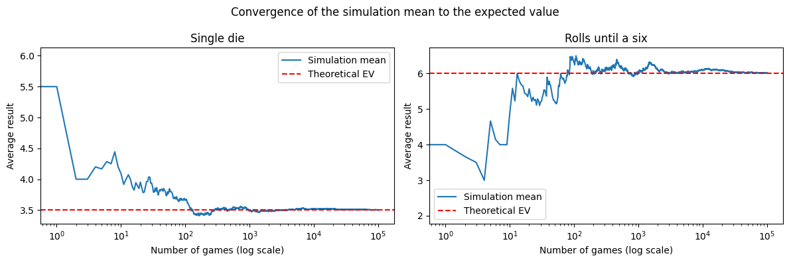
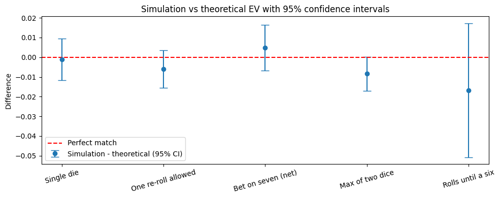
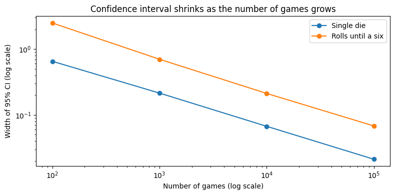
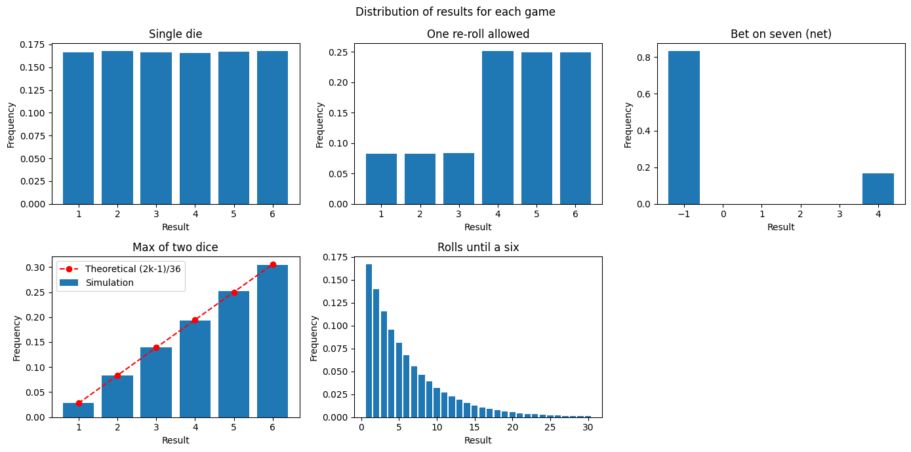

# Probability simulations: dice games and expected value

Monte Carlo simulation of five dice games. For each game I calculate the **expected value (EV) by hand**, simulate
the game **100,000 times** in Python and check whether the simulated average agrees with the theory using a
**95% confidence interval**.

Built as practice for probability and expected-value.



## Key results

| Game | EV (by hand) | Simulation | Difference | 95% CI | EV inside CI |
|---|---|---|---|---|---|
| Single die | 3.5000 | 3.5006 | +0.0006 | [3.4900, 3.5112] | ✅ |
| One re-roll allowed | 4.2500 | 4.2518 | +0.0018 | [4.2423, 4.2613] | ✅ |
| Bet on seven (net) | −0.1667 | −0.1613 | +0.0054 | [−0.1728, −0.1497] | ✅ |
| Max of two dice | 4.4722 | 4.4732 | +0.0010 | [4.4645, 4.4819] | ✅ |
| Rolls until a six | 6.0000 | 5.9925 | −0.0075 | [5.9586, 6.0264] | ✅ |

- In every game the hand-calculated EV lies inside the 95% confidence interval, so the differences are explained by
  normal randomness.
- **"Rolls until a six"** has the widest interval: its results are the most spread out, so its average needs the most
  trials to settle.
- **Expected value is not the most likely result:** in "Rolls until a six" the average is 6 rolls, but the most common
  outcome is 1 roll.

<p float="left">
  
  
</p>

## The games

| # | Game | Expected value |
|---|---|---|
| 1 | Roll one die, win its value in € | $\frac{1+2+3+4+5+6}{6} = 3.5$ |
| 2 | Roll one die, you may re-roll once (you must keep the second result) | Re-roll on 1–3: $\frac{3}{6}\cdot 3.5 + \frac{4+5+6}{6} = 4.25$ |
| 3 | Pay €1, win €5 if the sum of two dice is 7 (net result) | $4\cdot\frac{1}{6} - 1\cdot\frac{5}{6} = -\frac{1}{6}$ |
| 4 | Roll two dice, win the larger value | $P(\max = k) = \frac{2k-1}{36} \Rightarrow \frac{161}{36} \approx 4.472$ |
| 5 | Roll until a six appears: how many rolls on average? | Geometric distribution, $p = \frac{1}{6}$: $E = \frac{1}{p} = 6$ |



## What I did

1. **Hand calculations:** derived the expected value of each game before writing any code.
2. **Game functions:** each game is a small function that plays the game once and returns the result.
3. **Simulation:** a generic `simulation(game, times)` function plays any game many times and collects the results,
   so adding a new game only needs one new function.
4. **Metrics:** mean, standard deviation and a 95% confidence interval (mean ± 1.96 × standard error) for every game.
5. **Visualisation (matplotlib):** convergence of the running average, simulation vs theory with confidence intervals,
   distribution of results (with the theoretical probabilities for "Max of two dice") and how the confidence interval
   shrinks with more trials.

## What I learned

- **Law of large numbers:** the running average converges to the expected value, but small samples can be far off.
- **Spread matters:** games with more spread need more trials before their average can be trusted.
- **Precision is expensive:** the standard error falls with $\sqrt{n}$, so halving the uncertainty takes four times more
  simulations.

## Repository structure

```
├── images/                    # charts used in this README
├── notebooks/
│   └── dice_games.ipynb       # full analysis
└── requirements.txt
```

## How to run

Requires Python 3.12 or newer.

```bash
git clone https://github.com/grhnunlu/probability-simulations.git
cd probability-simulations
python -m venv .venv
source .venv/bin/activate          # Windows: .venv\Scripts\activate
pip install -r requirements.txt
jupyter lab notebooks/dice_games.ipynb
```
